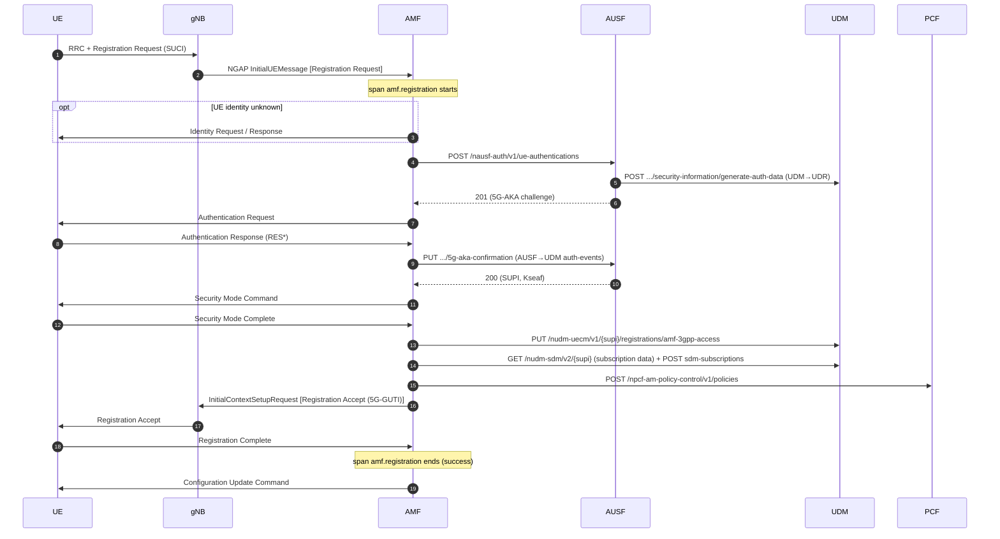
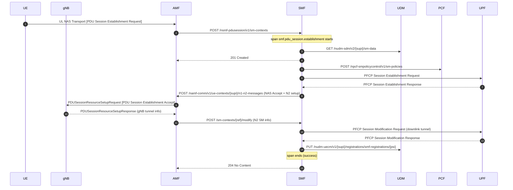

# 7. Walkthrough: 5G registration and PDU session, and what the PoC covers

This file explains what happens when a UE attaches to the 5G core in this lab,
and marks for each step what the PoC makes visible today.

Legend for the "PoC today" column:

| Mark | Meaning |
|---|---|
| **span** | Start or end of a PoC span |
| **event** | Span event (milestone) with a timestamp |
| **log** | AMF/SMF log line carrying the `trace_id` (clickable from the trace) |
| *within span* | Happens inside the span's duration, but there is no event of its own; the time is only visible as a gap between events |
| – | Not visible in the PoC trace. It is in the plain logs, or in Beyla's unconnected HTTP spans (see [08](08-distributed-tracing.md)). |

The UE and gNB are simulated by UERANSIM. Every SBI request in this
deployment goes **through the SCP** (indirect communication): an "AMF → AUSF"
call really is AMF → SCP → AUSF.

## 7.1 Registration (TS 23.502 §4.2.2.2.2, simplified to what Open5GS does)



| # | Step | What it is for | PoC today |
|---|---|---|---|
| 1–2 | Registration Request in InitialUEMessage | UE asks to attach and identifies itself with a **SUCI** (concealed IMSI) | **span** `amf.registration` starts; `5gs.registration.type`, `5gs.plmn_id`, `5gs.tac`, NGAP IDs; **log** "Registration request" |
| – | Identity Request/Response | Only when the AMF cannot identify the UE | **event** `identity_request_sent` |
| 3–5 | AUSF `ue-authentications` (AUSF → UDM → UDR) | Fetch an authentication vector for 5G-AKA | *within span*; **log** NF discovery "Setup NF Instance [type:AUSF]" |
| 6–7 | Authentication Request/Response | UE and network authenticate each other | **event** `authentication_request_sent` |
| 8–9 | AUSF `5g-aka-confirmation` | AUSF verifies RES*, returns the SUPI and key material | *within span* |
| 10–11 | Security Mode Command/Complete | Activate NAS ciphering and integrity | **event** `security_mode_command_sent`; **log** "Security mode complete" |
| 12 | UDM UECM `amf-3gpp-access` | Register this AMF as serving AMF at the UDM | *within span*; **log** "Setup NF Instance [type:UDM]" |
| 13 | UDM SDM get + subscribe | Load the subscription (allowed slices, AMBR, …) and subscribe to changes | *within span* |
| 14 | PCF AM policy | Access and mobility policy | *within span*; **log** "Setup NF Instance [type:PCF]" |
| 15–16 | InitialContextSetup + Registration Accept | Establish the UE context in the gNB, hand out a 5G-GUTI | **event** `registration_accept_sent` |
| 17 | Registration Complete | UE confirms the new GUTI | **event** `registration_complete_received`; **span ends** `success`; **log** "Registration complete", "[otel] procedure finished [outcome:success]" |
| 18 | Configuration Update Command | Time zone, network name to the UE | **log** (after the span end, same event) |

Failure paths covered with `outcome=failure`: Registration Reject (with
`5gs.5gmm.cause`), Authentication Reject, T3550 expiry (no Registration
Complete), GMM exception, and SBI transaction failures during the procedure.
A UE context removed mid-procedure gives `aborted`.

## 7.2 PDU session establishment (TS 23.502 §4.3.2.2.1)

Right after the registration, UERANSIM requests its configured session
(DNN `internet`, SST 1, SD `111111`).



| # | Step | PoC today |
|---|---|---|
| 1–2 | PDU Session Establishment Request → AMF → SMF `sm-contexts` | AMF: **span** `amf.pdu_session.establishment` starts (new trace, link to the registration); request span `POST nsmf-pdusession/sm-contexts`. SMF: **span** starts as its child |
| 3 | SMF fetches session subscription (UDM SDM) | *within span*; **log** "Setup NF Instance [type:UDM]" |
| 4 | 201 Created to the AMF | **event** `sm_context_created` (`pdusessioncreationsucc` is counted here) |
| 5 | PCF SM policy | **event** `pcf_sm_policy_created`; **log** "UE SUPI[…] DNN[…] IPv4[…]" (IP allocated) |
| 6–7 | PFCP Session Establishment with the UPF | **event** `pfcp_session_established` |
| 8–9 | N1N2 transfer, NAS Accept to the UE via the gNB | **event** `n1n2_accept_sent` |
| 10–11 | gNB answers, AMF forwards it to the SMF (`modify`) | **event** `n2_setup_response_received` |
| 12–13 | PFCP Session Modification (downlink path) | **event** `pfcp_session_activated`. **This is where the ~5 s PFCP retransmission delay shows up.** |
| 14 | UDM UECM SMF registration | **event** `udm_uecm_registered`; **span ends** `success` |
| 15 | 204 to the AMF | **log** "[otel] procedure finished" |

Failure paths covered: PDU Session Establishment Reject (`5gs.5gsm.cause`), the
N1N2 reject path (cause #38), gNB setup failure, UDM registration error
(`http.response.status_code`), GSM exception, and PFCP transaction timeouts
(log lines correlated).

## 7.3 How to read a trace from the PoC

Example: trace `83d517ee2944d5919f1c6a9f73348f6a`, an SMF session for UE …002:

```
smf.pdu_session.establishment  ██████████████████████████████████████████  5022 ms  success
  events: sm_context_created +5.5 ms
          pcf_sm_policy_created +11.8 ms
          pfcp_session_established +13.7 ms
          n1n2_accept_sent +13.7 ms
          n2_setup_response_received +18 ms
          pfcp_session_activated +5019.6 ms   <-- 5 s waiting for the UPF
          udm_uecm_registered +5022.5 ms
```

* **One bar = one span** = the whole procedure, measured inside one NF.
* **Events** are the milestones from the tables above. Their offsets are times
  since the span start. A big jump between two events tells you which step was
  slow, here the PFCP Session Modification.
* **The logs panel** lists every AMF/SMF log line written while this span was
  current. That is mostly NF discovery and state messages, because Open5GS logs
  many protocol details only at DEBUG level.
* **Registration and session are separate traces.** The session trace carries a
  span link to its registration trace (column `registration_trace` in the
  dashboard).
* Since image `9f0813191` the same session trace also contains one span per
  SBI and PFCP request. The 5 s above then shows up as a "PFCP Session
  Modification" span with two retransmission events. See
  [08](08-distributed-tracing.md) for the full tree.

## 7.4 Coverage summary

| Aspect | Covered today | Not covered (yet) |
|---|---|---|
| Procedures | Registration (AMF), PDU session establishment (SMF) | Deregistration, service request, handover, session release/modification by UE |
| Granularity | One span per procedure + milestone events + one span per SBI/PFCP request of AMF/SMF | Steps inside the other NFs |
| NFs | AMF, SMF | AUSF, UDM, UDR, PCF, NRF, SCP, UPF (only as the remote end of AMF/SMF request spans) |
| Cross-NF relation | `traceparent` AMF ↔ SMF; span link session → registration; shared `ue_ref` | Context into AUSF/UDM/PCF/UPF |
| Logs | All AMF/SMF lines during per-UE/per-session processing | Lines outside that, other NFs, SUPI still in log text |
| Metrics | Existing counters, compared by time | Exemplars |

Per-request spans and the AMF ↔ SMF relation are implemented as described in
[08-distributed-tracing.md](08-distributed-tracing.md). In the tables above,
every "*within span*" step that is an SBI request of AMF or SMF, or a PFCP
request, now also has its own request span with a duration.
