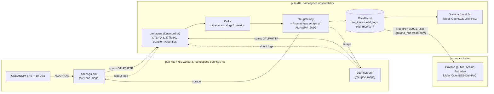

# Open5GS OpenTelemetry PoC – documentation

New here? Read [07-registration-walkthrough.md](07-registration-walkthrough.md) first. It explains the
5G procedures and what you see in a trace. Then continue with the topics below.

This folder documents the proof of concept on branch `otel-poc` of
`github.com/TobiPletsch/open5gs-otel`. The PoC adds manual OpenTelemetry tracing
to two Open5GS procedures. It ships the result to ClickHouse and shows it in
Grafana next to the existing Prometheus metrics and the NF logs.

| Signal | What is produced | How it is correlated |
|---|---|---|
| Traces | Registration trace: `amf.registration` + one span per SBI request of the AMF. PDU session trace: `amf.pdu_session.establishment` → `smf.pdu_session.establishment` + SBI and PFCP request spans | Registration ↔ session by **span link** |
| Logs | Existing Open5GS log lines with ` [trace_id=… span_id=…]` appended while a span is active | **Directly** by `TraceId`, one click from a trace to its logs |
| Metrics | Existing Prometheus counters (`fivegs_amffunction_rm_*`, `fivegs_smffunction_sm_*`), unchanged | **By time only**: same interval, side by side (no exemplars) |

## Topics

| File | Content |
|---|---|
| [01-code-changes.md](01-code-changes.md) | Every code change, file by file, and why it was done that way |
| [02-build.md](02-build.md) | Compiling Open5GS with opentelemetry-cpp and building the container image |
| [03-deployment.md](03-deployment.md) | Where it runs, which repos own what, telemetry pipeline, rollout procedure |
| [04-ue-registration.md](04-ue-registration.md) | Triggering UE registration, deregistration and PDU sessions with UERANSIM |
| [05-grafana-dashboard.md](05-grafana-dashboard.md) | Dashboard structure, every panel's query, and how logs and traces are linked |
| [06-limitations-and-troubleshooting.md](06-limitations-and-troubleshooting.md) | Known limitations, findings, and fixes for the problems hit so far |
| [07-registration-walkthrough.md](07-registration-walkthrough.md) | Registration and PDU session step by step, how to read a trace, and what the PoC covers per step |
| [08-distributed-tracing.md](08-distributed-tracing.md) | Per-request SBI/PFCP spans in AMF/SMF, `traceparent` propagation AMF ↔ SMF, registration and session traces linked by span link (implemented, image `9f0813191`) |

## Architecture at a glance

## Quick reference

| Item | Value |
|---|---|
| Source | `~/open5gs-otel` on `pub-k8s-w3`, branch `otel-poc` (base: upstream main v2.8.0-364) |
| Image | `docker.io/library/open5gs-otel:<git-sha>`, local to the containerd of `k8s-worker3` |
| Deployment repo | GitLab `tobias.pletsch/open5gs` (clone `~/tobi_projects/open5gs` on `pub-k8s-cp`), Flux Kustomization `open5gs-clab` |
| Collector / ClickHouse / pub-k8s Grafana | GitLab `dta9-workloads`, folder `observability/` (Flux `wl-observability`) |
| Public Grafana (NUC) | GitHub `assurance-services`, `apps/observability/` (Flux `observability` from `factory_infra`) |
| Rollout helper | `scripts/restart-core.sh` in the deployment repo |
